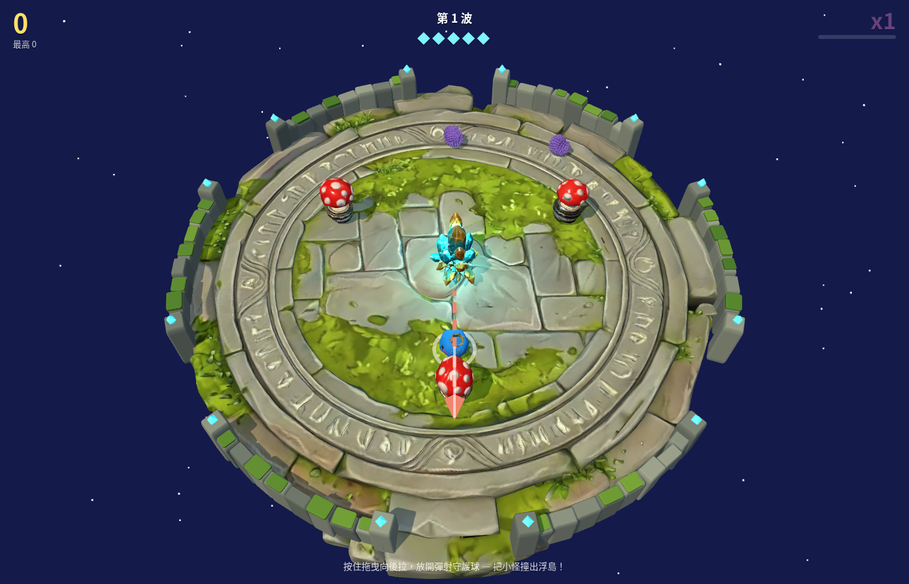

# 星之庭院保衛戰

**Star Garden Rumble** — 低面數 3D 物理防守街機原型：在浮島上用彈射守護球，把衝向水晶的小怪撞出場外。

**線上試玩：<https://malilion.github.io/star-garden-rumble/>**

[](https://vite.dev/)
[](https://threejs.org/)
[](https://rapier.rs/)
[](https://github.com/pmndrs/zustand)
[](LICENSE)


## 玩法

按住畫面任意處、向後拖曳拉弓，放開即可彈射守護球。瞄準時會進入慢動作，並顯示預測軌跡與反彈方向。把滾向中央水晶的小怪撞出浮島缺口、或撞飛越過圍欄即可得分；撞上彈力蘑菇會被彈開。水晶被碰到 5 次遊戲結束，可按「再來一局」重來。

本機最高分會記在瀏覽器的 `localStorage`。沒有帳號或後端。




## 操作

這是以指標操作的遊戲，沒有鍵盤快捷鍵。

| 操作 | 說明 |
| --- | --- |
| 按住並向後拖曳 | 拉弓瞄準（力度太小放開視為取消） |
| 放開 | 朝拉動的反方向彈射守護球 |
| 再來一局 | 水晶破碎後，點畫面上的按鈕重新開始 |

滑鼠、觸控與觸控筆都走同一套 Pointer Events。

## 功能

- 圓形浮島、帶缺口的苔石圍欄、中央水晶與彈力蘑菇
- 以 Rapier 驅動的高彈性守護球、碰撞擊飛與環出得分
- 敵人生成池（一般怪 / 重型怪），波次越後越快、越密
- 連擊倍率、螢幕震動、星星粒子與彈跳分數
- 瞄準預測線（含第一次反彈）

## 技術棧

Vite + Three.js + `@dimforge/rapier3d-compat` + Zustand。模型是 `public/models/` 裡的 GLB（由 `tools/split-models.mjs` 分割、簡化並壓縮）。手感與數值集中在 `src/config.js`。

## 本機開發

```bash
npm install
npm run dev      # 開發伺服器，走根路徑
npm run build    # 產出 dist/，預設 base 為 /star-garden-rumble/
npm run preview  # 預覽正式建置（含子路徑）
```

建置時的 `base` 預設為 `/star-garden-rumble/`，可用環境變數 `PAGES_BASE` 覆寫；GLB 路徑跟著 `import.meta.env.BASE_URL` 解析。`npm run dev` 一律走根路徑。

推送到 `main` 時，`.github/workflows/pages.yml` 會自動建置並部署到 GitHub Pages。Rapier 的 WASM 已內嵌在相容套件裡，不需要另載 `.wasm` 檔。

## 授權

本專案以 [MIT License](LICENSE) 授權。

3D 模型使用 [Hyper3D Rodin](https://hyper3d.ai/) 生成，同樣依 MIT 授權釋出。
